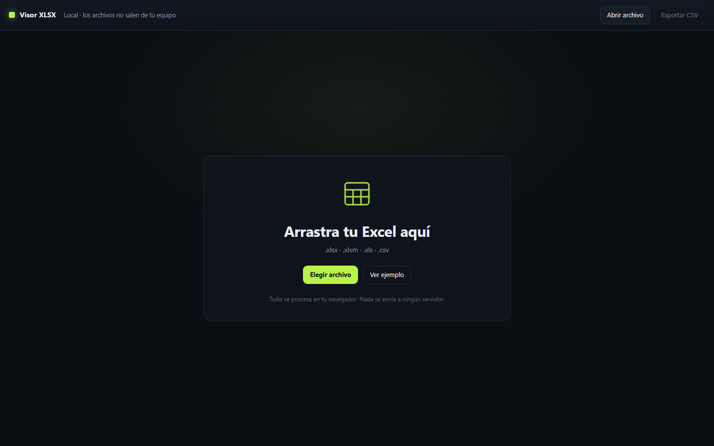

# Visor XLSX

**Abre Excel en Windows como una app. Rápido, local y sin subir nada.**

[](LICENSE)
[](https://github.com/smouj/xlsx-viewer/releases)
[](#instalación)
[](#privacidad)
[](https://sheetjs.com/)
[](https://smouj.github.io/xlsx-viewer/)

**Demo web:** https://smouj.github.io/xlsx-viewer/


Visor de hojas de cálculo **.xlsx**, **.xlsm**, **.xls** y **.csv** que se ejecuta en tu equipo. Sin servidor, sin cuenta, sin telemetría y sin subir el archivo a ninguna parte.

## Características

- **Ventana de app**: se abre sin pestañas ni barra de direcciones, con icono y acceso directo.
- **Todas las hojas** del libro, con pestañas y búsqueda por fila.
- **Todas las filas y columnas** del rango usado; la tabla virtualiza el dibujado para responder con archivos grandes.
- **Inspector de celda**: clic en cualquier celda para ver el contenido completo y copiarlo.
- **Fórmulas sin valor en caché** se muestran como fórmula en azul, sin dejar la celda vacía.
- **Exportar CSV** de la hoja activa, con UTF-8 y BOM para Excel.
- **100 % local**: funciona sin conexión y no hace peticiones de red.
- **Cero instalación**: HTML + JavaScript y la librería incluida en el repo.

## Instalación

1. Descarga el ZIP desde [Releases](https://github.com/smouj/xlsx-viewer/releases).
2. Descomprímelo en una carpeta permanente.
3. Doble clic en **Visor XLSX** (acceso directo) o en `launcher.vbs`.

No requiere administrador, instalador ni dependencias. Si mueves la carpeta, crea un acceso directo nuevo a `launcher.vbs` con `app.ico`.

### Desde el código

```bash
git clone https://github.com/smouj/xlsx-viewer.git
cd xlsx-viewer
```

Abre `index.html` en Chrome, Edge o Firefox. Para la ventana de app en Windows, ejecuta `launcher.vbs`.

## Uso

- Arrastra el archivo a la ventana o pulsa **Abrir archivo**.
- Cambia de hoja con las pestañas.
- Escribe en el buscador para filtrar filas de la hoja activa.
- Haz clic en una celda para ver su valor completo en la barra inferior.
- **Exportar CSV** descarga la hoja activa.

| Atajo | Acción |
|---|---|
| `Ctrl+O` | Abrir archivo |
| `←` / `→` | Hoja anterior / siguiente |
| `Esc` | Limpiar la búsqueda |

## Privacidad

El archivo se lee con `FileReader` y se procesa en memoria dentro del navegador. No hay backend, analíticas, cookies ni peticiones de red. El visor no modifica ni guarda el archivo original.

## Fidelidad de datos

- Se carga el rango usado completo de cada hoja, sin recortes artificiales de filas ni columnas.
- Las celdas muestran el valor formateado que guardó Excel; el inspector permite ver y copiar el contenido íntegro.
- Las fórmulas muestran su último valor calculado. Si el archivo no trae valor en caché, se muestra la fórmula.
- Las celdas combinadas conservan el valor en su celda superior izquierda, igual que Excel.

## Capturas



## Estructura

```
xlsx-viewer/
├─ index.html                 # interfaz y lógica del visor
├─ launcher.vbs               # ventana de app con Chrome o Edge
├─ app.ico                    # icono del acceso directo
├─ vendor/
│  ├─ xlsx.full.min.js        # SheetJS CE 0.20.3
│  └─ SHEETJS_LICENSE.txt     # Apache-2.0
├─ docs/
│  ├─ screenshot.png
│  └─ empty.png
├─ LICENSE
└─ THIRD_PARTY_NOTICES.md
```

## Desarrollo

No hay build ni gestor de paquetes: es HTML, CSS y JavaScript sin frameworks. La única dependencia es SheetJS, incluida en `vendor/`.

Para probar cambios, abre `index.html` y usa **Ver ejemplo**. La app incluye una hoja de demostración con dos pestañas.

## Limitaciones

- Visor de solo lectura: no edita ni guarda cambios en el archivo.
- Los archivos protegidos con contraseña no se pueden abrir.
- Hojas extremadamente grandes dependen de la memoria disponible del navegador.
- Las celdas combinadas se muestran en su celda de origen, sin repetir el valor.

## Licencia

Código del visor: [MIT](LICENSE). SheetJS Community Edition: Apache-2.0, detallado en [THIRD_PARTY_NOTICES.md](THIRD_PARTY_NOTICES.md).

Hecho por [SMOUJ013](https://github.com/smouj).
