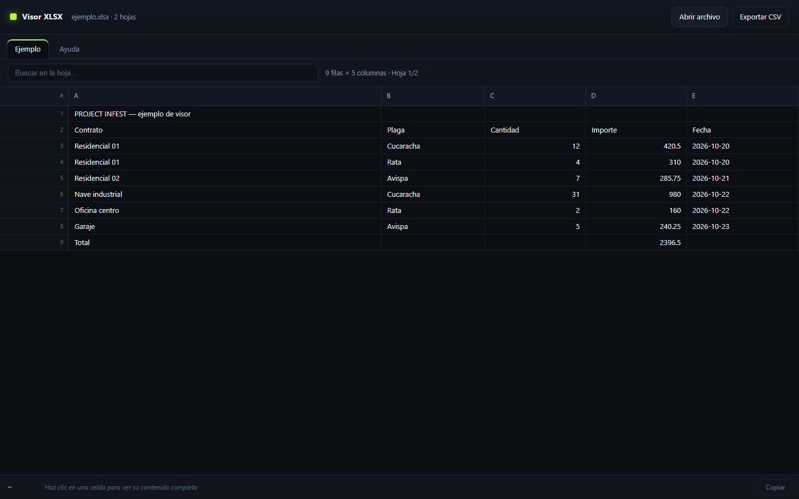

  

<h1 align="center">Voryda Sheet</h1>

  <strong>Open Excel workbooks locally in your browser or in a lightweight Windows app window.</strong>

  <a href="README.es.md">Español</a>

  
  
  
  
  
  
  
  

  <a href="#overview">Overview</a> ·
  <a href="#features">Features</a> ·
  <a href="#project-status">Status</a> ·
  <a href="#build-from-source">Build</a> ·
  <a href="#privacy">Privacy</a>

## Overview

**Voryda Sheet** is a read-only spreadsheet viewer for <code>.xlsx</code>, <code>.xlsm</code>, <code>.xls</code> and <code>.csv</code> files. It runs in the browser, with no account, server, analytics or file upload. A small Windows launcher can open it in an app-style window.

  <a href="https://smouj.github.io/xlsx-viewer/">Open the web demo</a> ·
  <a href="https://github.com/smouj/xlsx-viewer/archive/refs/heads/main.zip">Download the current source ZIP</a>

## Features

- Open workbooks with multiple sheets and switch between them using sheet tabs.
- Browse the used range of each sheet with virtualized row rendering for large files.
- Search rows in the active sheet and inspect or copy a cell's full value.
- Read common cell formatting, including fills, font colors, bold, italics, alignment, borders and text wrapping.
- Display embedded images, text boxes and supported charts in <code>.xlsx</code> and <code>.xlsm</code> files; click an object to enlarge it.
- Display images inserted in cells, with a larger view on click.
- Adjust column widths, wrap cell text and zoom the sheet from 50% to 200%.
- Export the active sheet as UTF-8 CSV with a BOM for Excel.
- Use the bundled app without a build step or package installation.

## Project status

The current source and browser demo are branded **Voryda Sheet**. The existing **v1.0.0** portable release predates this rebrand. Download the [current source ZIP](https://github.com/smouj/xlsx-viewer/archive/refs/heads/main.zip) to get the latest branding and app icon. The Windows launcher uses an installed copy of Chrome or Edge when available; opening <code>index.html</code> directly works in modern browsers.

The viewer is read-only. It does not edit or save changes to the source workbook. See [the supported behavior and limitations](#data-fidelity-and-limitations) before relying on complex Excel objects.

## Screenshot

## Requirements

- A modern browser for the web app: Chrome, Edge or Firefox.
- Windows with Chrome or Edge installed for the app-style launcher. If neither is found, the launcher opens <code>index.html</code> with the default browser.
- No server, account, installer or administrator access is required.

## Build from source

There is no build step or package manager. SheetJS Community Edition 0.20.3 is included in <code>vendor/</code>; the workbook reader and visual-object support run locally.

    git clone https://github.com/smouj/xlsx-viewer.git
    cd xlsx-viewer

Open <code>index.html</code> in a modern browser. On Windows, run <code>launcher.vbs</code> to open the app-style window. Select **View example** in the app to load the bundled sample workbook.

## Use the viewer

1. Drop a workbook into the window or choose **Open file**.
2. Switch sheets with the tabs, or search rows in the active sheet.
3. Click a cell to inspect and copy its full value.
4. Use the zoom controls to change the sheet scale, or choose **Export CSV** for the active sheet.

| Shortcut | Action |
| --- | --- |
| <kbd>Ctrl</kbd>+<kbd>O</kbd> | Open a file |
| <kbd>←</kbd> / <kbd>→</kbd> | Previous / next sheet |
| <kbd>Esc</kbd> | Clear the search |
| <kbd>Ctrl</kbd>+<kbd>+</kbd> / <kbd>Ctrl</kbd>+<kbd>-</kbd> | Zoom in / out |

## Local data and privacy

Voryda Sheet reads selected files with the browser's <code>FileReader</code> API and processes them in memory. The app has no backend, analytics, cookies, upload path or network requests. The original workbook is not modified or saved by the viewer. The online demo is hosted separately on GitHub Pages.

## Data fidelity and limitations

- Each sheet's used range is loaded without an artificial row or column cutoff. Large sheets still depend on available browser memory.
- Cell values use the formatted values stored in the workbook; the cell inspector shows the complete value. Formulas display their last cached result, or the formula itself when no cached result is present.
- Common cell styles, row and column sizes, hidden rows and columns, and merged-cell values are supported.
- Embedded and in-cell PNG, JPEG, GIF, BMP, WebP and SVG images, text boxes, and column, bar, line, area, pie and doughnut charts are supported. Click images or charts for an enlarged view.
- Charts are redrawn locally. Their exact Excel palette, typography, axes and layout are not retained. Scatter, radar, bubble and area charts are rendered as lines; a combined chart follows its first chart type. Cached chart data or source-cell values are used.
- Full style and visual-object extraction is limited to <code>.xlsx</code>/<code>.xlsm</code> files up to 64 MB. Larger books still load their grid and values, but style and object extraction is skipped.
- Conditional formatting, pivot tables, slicers, SmartArt, OLE objects and 3D charts are not reproduced. Unsupported embedded objects are shown with an information card when possible.
- Password-protected workbooks cannot be opened. The app is a viewer and does not edit or save workbooks.

## License

Voryda Sheet is distributed under the [MIT License](LICENSE). SheetJS Community Edition is distributed under Apache-2.0; see [the third-party notices](THIRD_PARTY_NOTICES.md).

---

  <strong>Voryda</strong> 
  Focused Windows utilities.

  <a href="https://github.com/smouj/voryda-snap">Snap</a> ·
  <a href="https://github.com/smouj/voryda-rec">Rec</a> ·
  <a href="https://github.com/smouj/voryda-down">Down</a> ·
  <a href="https://github.com/smouj/voryda-cut">Cut</a> ·
  <a href="https://github.com/smouj/xlsx-viewer">Sheet</a>

